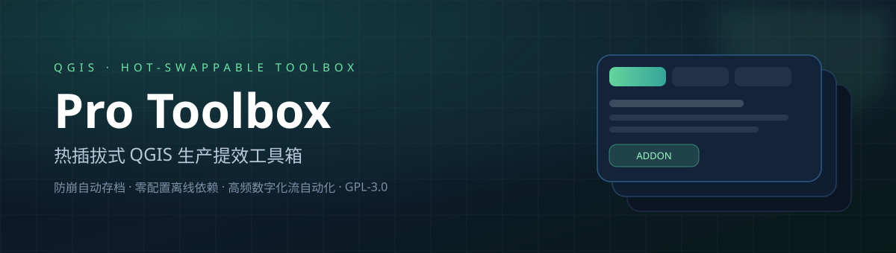
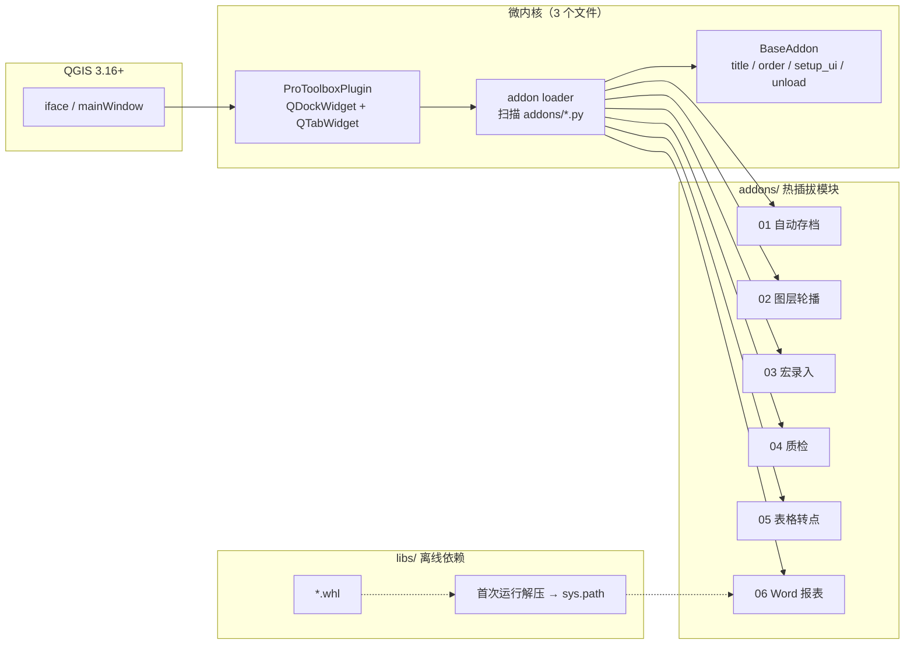

<div align="center">



### 热插拔 · 零配置 · 抗崩溃

**把 QGIS 变成一条可组装的数字化生产线，而不是一台每次上新功能都要重装的软件。**

[](https://qgis.org)
[](LICENSE)
[](https://www.python.org)
[]()
[](https://github.com/KGSINYA/qgis-pro-toolbox/pulls)

[核心特性](#-核心特性) · [架构](#-架构一览) · [3 分钟扩展](#-3-分钟扩展指南) · [安装](#-安装) · [离线依赖](#-内网离线依赖-zero-config) · [FAQ](#-faq)

</div>

> **English** — Pro Toolbox is a hot-swappable addon shell for QGIS: one 21-line `BaseAddon` contract, a runtime scanner, and offline wheels. Drop a `.py` file into `addons/`, click **Rescan**, and a new tab appears without restarting QGIS. Six production modules ship in the box: crash-proof autosave with one-click restore, arrow-key layer cycling, numpad macro input, semi-automatic QA/QC, table-to-point mapping with batch map export, and template-driven Word reports. No network calls, no telemetry.

---

## 🎯 为什么是 Pro Toolbox？

内业数字化真正的成本，从来不是「软件功能不够」，而是**重复动作 × 每天 8 小时 × 每一次意外崩溃**。

| 现场的真实痛点 | 常见做法 | Pro Toolbox 的做法 |
| --- | --- | --- |
| 连续作业一下午，QGIS 崩一次 = 半天白干 | 手动另存，靠记性 | 定时把**正在编辑的图层**快照成独立 GPKG，按数量轮转，一键回溯成新图层 |
| 影像/矢量比对要在图层面板里点来点去 | 鼠标点 4 次才切一张 | `←` / `→` 在组内轮播，画布顶部 OSD 提示，视线不用离开作业区 |
| 属性表里反复复制粘贴同一段话 | 输入法词库、复制粘贴 | 小键盘 `1–5` 直出长文本 + 自动回车，Win32 级注入，不抢 QGIS 快捷键 |
| 质检靠肉眼翻页、靠纸单勾选 | 人工比对 | `F4` 标记合格 → 自动缩放并跳到下一个未检要素 |
| Excel 坐标要变成图、再批量出图 | 跨 3 个软件 + 手工 | 表格转点、SHP 导出、96/150/300 DPI 批量出图一条龙 |
| 每个项目都要重做 Word 报表 | 复制粘贴到吐 | 拿现有 `.docx` 当模板，按表头映射字段与照片，批量生成 |

### 三个设计取向

**🧩 热插拔微内核（Hot-Swappable Addon Architecture）**
框架只有 3 个文件：`main.py` 负责 Dock / Tab / 扫描，`base_addon.py` 是一份 21 行的契约，`__init__.py` 是入口。**新增功能 = 新增一个文件**，不改框架、不重装插件、不重启 QGIS。

**📦 内网离线免安装依赖（Zero-Config Offline Libs）**
`libs/*.whl` 随插件分发，首次运行自动解压并挂载到 `sys.path`。没有 pip、没有外网、没有管理员权限，也能用 `python-docx` 出报表。

**⚡ 高频数字化流自动化**
所有交互都为「手不离键盘、眼不离画布」设计：方向键、小键盘、单键质检、一键回溯。

---

## ✨ 核心特性

| # | 模块 | 入口 | 解决什么 | 产出 / 行为 |
| --- | --- | --- | --- | --- |
| 01 | 💾 **自动存档 & 一键回溯** | Dock 面板 | 崩溃、误操作导致编辑成果丢失 | `Backup_YYYYmmdd_HHMMSS/<图层>.gpkg`，可设最多保留 N 份，自动轮转删旧 |
| 02 | 🗂️ **图层轮播** | `←` / `→` | 图层面板来回点，打断作业节奏 | 在当前图层组内切换可见性，画布 OSD 显示当前图层名 |
| 03 | ⌨️ **小键盘宏录入** | `Numpad 1–5` | 长文本、固定话术反复输入 | 全局热键拦截 → Unicode 注入，可选自动回车；配置本地 JSON 持久化 |
| 04 | ✅ **半自动质检** | `F4`（可选 `F5` / `Space` / `F8`） | 质检流程靠翻页与肉眼 | 初始化 `QA_Status` 字段 → 标记合格 → 自动跳下一个未检要素 |
| 05 | 📊 **表格转点 & 批量出图** | Dock 面板 | Excel 坐标 → 成图，跨软件搬运 | 坐标跳转、度分秒解析、经纬填反纠错、图面取点；CSV/XLSX 转点、导出 SHP、批量出图 |
| 06 | 📝 **Word 报表** | Dock 面板 | 每期报表重复排版 | 读取 `.docx` 模板首行表头，按列映射「矢量字段 / 外部图片」，逐要素填充 |

### 技术规格

| 项 | 说明 |
| --- | --- |
| 运行环境 | QGIS **3.16 – 3.99**（Qt5 / PyQt5） |
| 语言 | Python 3（使用 QGIS 内置解释器） |
| 第三方依赖 | `python-docx 1.2.0`、`lxml 6.1.3`、`typing_extensions 4.16.0` —— 随包内置，无需安装 |
| 平台 | Windows / macOS / Linux（`03 小键盘宏` 仅 Windows，其余模块跨平台） |
| 网络 | 不发起任何网络请求，不上报任何数据 |

---

## 🏗 架构一览



```
qgis-pro-toolbox/
├── __init__.py             # QGIS 入口：classFactory()
├── main.py                 # 微内核：Dock + Tab + 模块扫描器
├── base_addon.py           # 21 行的模块契约
├── metadata.txt            # QGIS 官方插件元数据
├── LICENSE                 # GPL-3.0 全文（无扩展名，官方要求）
├── NOTICE                  # 版权声明与第三方依赖许可
├── icon.png                # 插件图标（metadata 中声明）
├── build_zip.py            # 一键打包为可上传的 ZIP
├── addons/
│   ├── 01_auto_save.py
│   ├── 02_layer_switch.py
│   ├── 03_numpad_macro.py
│   ├── 04_qaqc.py
│   ├── 05_excel_map.py
│   ├── 06_word_report.py
│   └── _template_addon.py  # 模板：下划线开头不会被加载
├── libs/                   # 离线 wheel（解压产物不入库）
└── docs/
    ├── banner.svg
    └── security-audit.md   # 开源前脱敏审计报告
```

**为什么能这么薄？**

1. **契约最小** —— 一个模块只需要 `title`、`order`、`setup_ui(parent_widget)`，其余全部可选。
2. **失败隔离** —— 单个模块 import 或初始化抛异常时，主框架只弹一条消息栏提示，**其余模块照常加载**。
3. **资源可回收** —— 每个模块都有 `unload()`；「重新扫描」会先卸载旧实例，再重新发现，不会留下幽灵定时器和快捷键。

---

## 🧩 3 分钟扩展指南

新建 `addons/07_hello.py`，就这 15 行：

```python
# addons/07_hello.py   ← 文件名不能以 "_" 开头，否则会被加载器跳过
from qgis.PyQt.QtWidgets import QVBoxLayout, QLabel
from base_addon import BaseAddon


class HelloAddon(BaseAddon):
    title = "👋 你好模块"      # Tab 标题
    order = 7                 # 排序，越小越靠前

    def setup_ui(self, parent_widget):
        layout = QVBoxLayout(parent_widget)
        layout.addWidget(QLabel("零重启挂载成功 —— 这就是微内核。"))

    def unload(self):
        pass                  # 在这里停定时器 / 注销快捷键 / 结束线程
```

保存 → 在 Dock 顶部点 **🔄 重新扫描加载模块** → 新 Tab 立刻出现。**没有改过一行框架代码，也没有重启 QGIS。**

### 模块契约

| 成员 | 必需 | 作用 |
| --- | --- | --- |
| `title` | 否 | Tab 名称，默认 `🧩 未命名模块` |
| `order` | 否 | 排序权重，默认 `99`（数字越小越靠前） |
| `setup_ui(parent_widget)` | **是** | 构建 UI；`parent_widget` 是一个空的 `QWidget`，直接在上面布局即可 |
| `unload()` | 否 | 卸载 / 重扫时清理资源 |
| `_is_pro_addon` | — | 框架标记；子类置 `False` 可让模块在特定平台自动隐藏 |

### 三条铁律

1. **文件名不要以 `_` 开头** —— 加载器会跳过（`_template_addon.py` 就是靠这个常驻仓库而不生效）。
2. **不要在 `setup_ui` 里做耗时 IO** —— 它在 UI 线程执行；读大文件请用 `QTimer.singleShot(0, ...)` 延后。
3. **有定时器 / 快捷键 / 线程的模块必须实现 `unload()`** —— 否则「重新扫描」会留下幽灵资源。

> 仓库里已经放了一份可复制的 [`addons/_template_addon.py`](addons/_template_addon.py)。

---

## 📥 安装

### 方式 A：ZIP 离线安装（内网 / 无 Git 环境推荐）

1. 在 [Releases](https://github.com/KGSINYA/qgis-pro-toolbox/releases) 下载 `qgis_pro_tools-1.0.0.zip`；
2. QGIS → **插件 → 管理并安装插件 → 从 ZIP 安装**；
3. 选择该 ZIP，安装完成后勾选启用；
4. 工具栏出现 🛠️ 图标，点击即可打开工具箱。

> ZIP 内第一层必须是 `qgis_pro_tools/` 文件夹。用 `build_zip.py` 打包会自动保证这一点。

### 方式 B：源码克隆（开发者推荐）

```bash
# Windows
cd "%APPDATA%\QGIS\QGIS3\profiles\default\python\plugins"
git clone https://github.com/KGSINYA/qgis-pro-toolbox.git qgis_pro_tools
```

```bash
# macOS
cd ~/Library/Application\ Support/QGIS/QGIS3/profiles/default/python/plugins
git clone https://github.com/KGSINYA/qgis-pro-toolbox.git qgis_pro_tools
```

```bash
# Linux
cd ~/.local/share/QGIS/QGIS3/profiles/default/python/plugins
git clone https://github.com/KGSINYA/qgis-pro-toolbox.git qgis_pro_tools
```

克隆后重启 QGIS，在插件管理器中勾选 **Pro Toolbox**。

### 验证安装

打开工具箱 → 底部状态应显示 `已加载模块: 6 个`。若某个模块加载失败，消息栏会指出具体文件名与异常。

---

## 🔌 内网离线依赖（Zero-Config）

`libs/` 中内置了三个 wheel：

| Wheel | 用途 |
| --- | --- |
| `python_docx-1.2.0-py3-none-any.whl` | Word 报表 |
| `lxml-6.1.3-cp312-cp312-win_amd64.whl` | python-docx 的 XML 后端 |
| `typing_extensions-4.16.0-py3-none-any.whl` | 类型标注兼容层 |

首次使用 Word 报表时，`06_word_report.py` 会把 wheel 解压到插件目录并 `sys.path.insert`，同时写入 `*.whl.unpacked` 戳记，第二次启动直接复用。

### ⚠️ 运行时版本要求（必读）

`libs/` 里的 wheel 是**预编译二进制**，与 QGIS 自带的 Python 版本强绑定。当前内置的 `lxml-6.1.3-cp312-cp312-win_amd64.whl` 为 **CPython 3.12 / Windows x64** 编译：

| 你的 QGIS（Windows 官方构建） | 自带 Python | 内置 wheel | 需要做什么 |
| --- | --- | --- | --- |
| **3.34 及以上** | **3.12** | ✅ 开箱即用 | 无 |
| 3.16 – 3.32 | 3.9 | ❌ `import lxml` 报 ABI 不匹配 | 换成 `cp39` 的 lxml wheel |
| macOS / Linux | 各自版本 | ❌ 平台不匹配 | 换成对应 `--platform` 的 wheel |

> 限制来自 wheel 的二进制 ABI（`cp312` 只能跑在 Python 3.12 上），**不是插件代码的限制**。
> 其余 5 个模块（自动存档、图层轮播、宏录入、质检、表格转点）完全不依赖 `libs/`，在 QGIS 3.16+ 均可正常运行；**只有「Word 报表」模块需要版本匹配的 wheel**。

查当前 QGIS 的 Python 版本：**插件 → Python 控制台**，执行

```python
import sys; print(sys.version)
```

在联网机器上重新抓取匹配的 wheel（不锁定版本，pip 会自动选择适配该 Python 的最新版）：

```bash
# QGIS 3.34+（Python 3.12 / Windows x64）
python -m pip download lxml --only-binary=:all: --platform win_amd64 --python-version 3.12 --implementation cp -d libs

# QGIS 3.16 – 3.32（Python 3.9 / Windows x64）
python -m pip download lxml --only-binary=:all: --platform win_amd64 --python-version 39 --implementation cp -d libs
```

> `pandas` / `openpyxl` 等表格依赖由 QGIS 自带，无需打包。

---

## ⌨️ 快捷键速查

| 快捷键 | 模块 | 动作 |
| --- | --- | --- |
| `←` / `→` | 02 图层轮播 | 在当前图层组内切换上一个 / 下一个图层 |
| `Numpad 1` – `Numpad 5` | 03 宏录入 | 注入预设文本（可配置自动回车），仅 Windows |
| `F4` | 04 质检 | 标记当前要素合格，并跳转到下一个 `QA_Status` 为空的要素 |
| `F5` / `Space` / `F8` | 04 质检 | 可在面板下拉框中改绑 |

> `02` 与 `04` 的快捷键可在各自面板中启用 / 停用，避免与你的项目快捷键冲突。

---

## 🛡 隐私与安全

- **零联网**：代码中不存在任何 `urllib` / `requests` / `QNetwork` / `socket` / `subprocess` 调用，插件不会向外发送任何数据。
- **零遥测**：不收集使用统计、不写注册表、不上传工程信息。
- **数据留在本机**：自动存档写在你指定的目录，Word 报表输出到你选择的位置。
- **已脱敏**：仓库内不含公司名、内网地址、个人路径、项目代号。审计细节见 [`docs/security-audit.md`](docs/security-audit.md)。

---

## ❓ FAQ

**Q：点了「重新扫描」，新 Tab 没出现？**
A：检查三件事 —— 文件名不是 `_` 开头、类继承了 `BaseAddon`、`setup_ui` 签名是 `(self, parent_widget)`。具体异常会显示在 QGIS 消息栏（视图 → 面板 → 日志消息）。

**Q：自动存档存在哪里？会占满硬盘吗？**
A：存在你在面板中选择的目录，每次存档生成 `Backup_时间戳/` 子目录。面板里可设置最多保留份数，超出后自动删除最旧的一份。

**Q：Word 报表报 `No module named 'docx'` 或 `ImportError: DLL load failed`？**
A：`libs/` 中的 wheel 与当前 QGIS 的 Python 版本不匹配（内置为 `cp312`，对应 QGIS **3.34+**；3.16–3.32 为 Python 3.9，需要 `cp39` 的 lxml）。替换方法见[内网离线依赖](#-内网离线依赖-zero-config) 的「运行时版本要求」。

**Q：杀毒软件对宏录入报警？**
A：`03` 模块使用 Win32 `RegisterHotKey` + `SendInput` 实现全局热键与文本注入，这是输入法、自动化工具的常规做法，不涉及注入其他进程。介意可停用该模块。

**Q：支持 QGIS 4 / Qt6 吗？**
A：目前锁定 `qgisMaximumVersion=3.99`。Qt6 版本需要把 `Qt.Key_Left` 这类写法改成作用域枚举，属于已知的迁移工作，欢迎 PR。

**Q：能在 macOS / Linux 上用吗？**
A：可以。除 `03 小键盘宏`（依赖 Win32 API，会自动隐藏）外，其余模块均跨平台。

---

## 🗺 Roadmap

- [x] `1.0.0` 首个公开版本：6 个生产模块 + 热插拔加载器
- [ ] QGIS 4 / Qt6 适配
- [ ] 模块启用 / 禁用开关与配置持久化
- [ ] 自动存档的差异备份（仅存变更要素）
- [ ] 中英文界面双语化

---

## 🤝 参与贡献

PR 与 Issue 都非常欢迎，尤其是：

- 新的 `addons/` 模块（请附带一段 GIF 或截图）；
- 跨平台适配（macOS / Linux 下的热键替代方案）；
- 文档翻译与错别字修正。

提交前请确认：`python build_zip.py --dry-run` 能正常列出文件，且没有把本地配置、缓存或测试数据带进仓库。

---

## 📄 许可证

本项目基于 [GNU General Public License v3.0](LICENSE) 发布（`LICENSE` 为 GPL-3.0 全文，版权归属与第三方依赖许可见 [NOTICE](NOTICE)）。
QGIS 官方插件仓库要求所有插件使用 GPL v2 或更高版本协议，本项目选择 GPL-3.0。

---

## 👤 作者

| | |
| --- | --- |
| 作者 | KGSINYA |
| 邮箱 | [kgsinya@163.com](mailto:kgsinya@163.com) |
| GitHub | [@KGSINYA](https://github.com/KGSINYA) |
| 问题反馈 | [Issues](https://github.com/KGSINYA/qgis-pro-toolbox/issues) |

> 如果这个项目帮你省下了加班时间，点一个 ⭐ 就是最好的支持。

---

## ⚠️ 免责声明

本项目与 QGIS.org / OSGeo 无隶属关系，QGIS 是 QGIS.org 的注册商标。
插件会修改当前工程的图层字段与编辑状态，**请在生产数据上使用前先备份工程**。作者不对任何数据丢失或生产事故承担责任。
