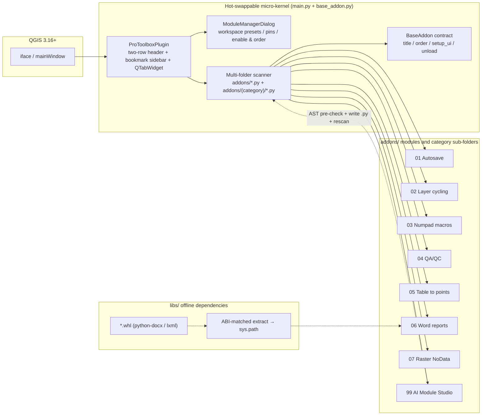

<div align="center">


[English](./README.md) | [简体中文](./README_zh.md)

### Hot-swappable · AI self-evolving · Zero-config · Crash-resistant

**Turn QGIS into a production line you can assemble on demand — and extend with AI-created tools — instead of reinstalling software every time you need a new button.**

[](https://qgis.org)
[](https://github.com/KGSINYA/qgis-pro-toolbox/releases)
[](LICENSE)
[](https://www.python.org)
[]()
[](https://github.com/KGSINYA/qgis-pro-toolbox/pulls)

[🆕 What's new in v1.1.0](#-whats-new-in-v110) · [📖 Step-by-step guide](#-step-by-step-guide-first-time-users) · [✨ Modules](#-8-built-in-production-modules) · [🏗 Architecture](#-architecture) · [🧩 Extend in 3 minutes](#-3-minute-extension-guide) · [📥 Install](#-installation) · [❓ FAQ](#-faq)

</div>

> **English** — Pro Toolbox is a hot-swappable addon shell for QGIS: one 32-line `BaseAddon` contract, a multi-folder runtime scanner, an AI Module Studio, and offline wheels. Drop a `.py` file into `addons/`, click **Rescan**, and a new tab appears without restarting QGIS. Eight production modules ship in the box — crash-proof autosave with one-click restore, arrow-key layer cycling, numpad macro input, semi-automatic QA/QC, table-to-point mapping with batch map export, template-driven Word reports, a raster NoData cleaner, and an AI Module Studio — on top of a folder-based module library with collapsible horizontal bookmarks. No network calls, no telemetry.

> **Pro Toolbox** is a plugin base built for hot-swapping and AI self-evolution: a 32-line `BaseAddon` contract, a runtime scanner that understands category sub-folders, and a set of offline wheels. Drop a `.py` into `addons/`, click **🔄 Rescan & Reload**, and the new tab shows up immediately — no QGIS restart. Eight production modules are included: crash-proof autosave with one-click restore, arrow-key layer cycling, numpad macro input, semi-automatic QA/QC, table-to-point mapping with batch map export, template-driven Word reports, a raster NoData/black-border cleaner, and an AI Module Studio — plus a collapsible left bookmark bar and a workspace manager.

---

## 🆕 What's new in v1.1.0

| Feature | The one-line value |
|---|---|
| **✨ 99 · AI Module Studio** | **Turn "I wish I had a tiny tool" into a 30-second job**: describe it in plain language → copy the generated contract-perfect prompt → send it to DeepSeek/ChatGPT/Claude → paste the code back. The studio AST-checks syntax and contract compliance, writes it into `addons/`, and hot-mounts it as a new tab. No QGIS restart, no code editor. |
| **🔖 Category bookmark sidebar & ⚙️ module manager** | **No more crowded tab rows or manually shuffling `.py` files**: organize modules into sub-folders under `addons/`; the left bookmark bar renders horizontally (never rotated text) and collapses with one click; pin everyday tools as **`📌 Global Pin`**, enable/disable with checkboxes, reorder with `⬆️/⬇️`, and save multiple task workspace presets for one-second switching. |
| **🖼️ 07 · Raster NoData cleaner** | **For the black/white collars on orthomosaics (DOM) and scanned maps**: set NoData to `0` (black) or `255` (white) in one click, or make any exact RGB value transparent; enable **auto-watch for newly added rasters**, smooth bilinear resampling and contrast stretching. |
| **🧪 Headless QGIS smoke suite** | New `tests/test_plugin_smoke.py`: boots QGIS offscreen, mounts all 8 modules, validates UI construction, category sub-folder discovery, workspace JSON persistence and live CN/EN switching. |

---

## 📖 Step-by-step guide (first-time users)

The recent release added a lot of module-management and AI tool-making power. Even with zero programming background, the three tables below get you productive in a minute.

### Tutorial 1: Declutter your toolbox with the ⚙️ module & category manager

When your module count grows (daily core tools plus per-project drone/surveying modules), organize them like this:

| Step | Where to click | What happens |
|---|---|---|
| **Step 1 — open the manager** | Click **`⚙️ Module Manager`** in the first row of the dock header (or **`⚙️ Organize Modules`** at the bottom of the left sidebar) | A visual tree dialog opens, listing the `addons/` root plus the four preset category folders `01_通用核心模块`, `02_遥感影像处理`, … |
| **Step 2 — file a module into a category** | Select a module (e.g. `07_影像去黑边`) → click **`📁 Move to Category Folder...`** → choose `02_遥感影像处理` (or type a new folder name) | The plugin creates the sub-folder on disk and moves the `.py`; the **left bookmark bar** and the header drop-down immediately show `📂 02_遥感影像处理 (1)`. |
| **Step 3 — pin your daily drivers** | Select a module you use every day (e.g. `01_自动存档`) → click **`📌 Toggle Global Pin`** | The module is marked **`📌 Global Pin`** and stays visible at the top of *every* category bookmark you switch to. |
| **Step 4 — hide and reorder without touching files** | • **Hide a module**: uncheck its `⬜` checkbox<br>• **Reorder**: select it and click **`⬆️ Up` / `⬇️ Down`** | No disk surgery, no renaming `01_`, `02_` prefixes. Your order overrides the built-in `order` value. |
| **Step 5 — save a task workspace** | Click **`➕ New Preset`** (e.g. `🛩️ Aerial mapping mode`), tick the cross-folder module mix for that task, then **`✅ Save & Reload UI`** | Switch the whole panel in 0.1 s from the left bookmarks or the header drop-down. Sidebar in the way? Click **`◀ Collapse sidebar`**. |

---

### Tutorial 2: Let the ✨ 99 · AI Module Studio build a custom tool in 30 seconds

You do not need to know the PyQGIS API — the studio bakes this plugin's contract (`BaseAddon`, `setup_ui`, `tr()` bilingual wrapping) into the prompt generator:

| Step | What you do | Pitfall to avoid |
|---|---|---|
| **Step 1 — describe it, copy the prompt** | Switch to the last tab **`✨ 模块工坊 (AI造工具)`**:<br>1. Fill in the module file name (auto-numbered, e.g. `08_my_custom_tool.py`) and the tab title.<br>2. Describe the need in plain language in the first box (e.g. *"Batch export the selected vector layer split by a field into multiple GeoJSON files, with a progress bar"*).<br>3. Click the blue **`📋 Generate base-compatible prompt and copy to clipboard`** button. | Never just tell an AI "write me a QGIS plugin". Always use the blue button — it copies the `setup_ui(parent_widget)` mounting contract so the generated code fits this toolbox. |
| **Step 2 — send to any AI, paste the code back** | 1. Open DeepSeek / ChatGPT / Claude / Kimi and paste.<br>2. Copy the Python code back into the second code box (Markdown fences are fine — the studio strips them).<br>3. Click the green **`⚡ Validate, write to addons, hot-reload!`** button. | The studio first runs a Python AST check for syntax errors and for a missing `BaseAddon`/`setup_ui`; once it passes, the file is saved and hot-reloaded — **the new tab appears right away**. |

---

### Tutorial 3: Erase black/white collars with 🖼️ 07 · Raster NoData cleaner

Orthomosaics (DOM) and old scanned maps usually arrive with a black (`RGB=0,0,0`) or white (`RGB=255,255,255`) invalid border:

| Scenario | Steps |
|---|---|
| **Quick black/white removal** | Open **`🖼️ 07. 影像去黑边`** → choose the scope (`current raster layer` or `all rasters in the project`) → click **`⬛ Remove black collar (NoData = 0)`** or **`⬜ Remove white collar (NoData = 255)`**. Instant transparency. |
| **Hands-off workflow (recommended)** | Tick **`⚡ Auto-clean newly added rasters (NoData = 0)`**. Every TIF you drag into QGIS is cleaned in the background and the canvas refreshes — no button clicks at all. |
| **Jagged edges / too dark** | Click **`✨ Enable smooth resampling + min/max contrast stretch`** to switch the layer to bilinear interpolation and dynamic range stretching; click **`🔄 Restore default rendering`** to undo. |

---

## 🎯 Why Pro Toolbox?

The real cost of digital production is not "missing features" — it is **repetition × 8 hours a day × every unexpected crash**.

| Real-world pain | Common workaround | What Pro Toolbox does |
| --- | --- | --- |
| One QGIS crash after a long afternoon = half a day lost | Save manually, rely on memory | Snapshot the **layer being edited** into a separate GPKG on a timer, rotate by count, restore as a new layer in one click |
| Comparing imagery/vector versions means clicking the layer tree | Four clicks per switch | `←` / `→` cycle visibility inside the group, with an on-canvas OSD hint so your eyes stay on the map |
| Pasting the same paragraph into the attribute table all day | IME phrase libraries, copy-paste | Numpad `1–5` injects long text + optional Enter at Win32 level, never stealing QGIS shortcuts |
| QA by eyeballing pages and ticking paper lists | Manual comparison | `F4` marks pass → auto-zoom and jump to the next unchecked feature |
| Excel coordinates must become points, then maps in bulk | Three apps + manual work | Table-to-point, SHP export and 96/150/300 DPI batch map export in one flow |
| Every project needs the same Word report rebuilt | Copy-paste until you cry | Use an existing `.docx` as template, map fields and photos by header, batch generate |
| A big black collar hides the basemap under your orthomosaic | Right-click properties and type transparency values one by one | Batch NoData / RGB transparency, plus auto-watch for newly dragged-in rasters |
| A one-off batch tool is missing | Wait for a release, reinstall the plugin | Open the 99 Module Studio; 30 seconds later AI-generated code is hot-mounted |

---

## ✨ 8 built-in production modules

| # | Module | Entry point | Pain it removes | What it actually does |
| --- | --- | --- | --- | --- |
| **01** | 💾 **Autosave & one-click restore** | Dock panel | Crashes and accidental deletions wiping hours of edits | Scans editable vector layers, snapshots them to `Backup_YYYYmmdd_HHMMSS/<layer>.gpkg` on a timer, rotates old snapshots by a max-count setting, and **mounts any historical snapshot back into the project** for comparison. |
| **02** | 🗂️ **Layer cycling** | `←` / `→` | Bouncing around the layer tree when comparing imagery/plans | After locking a target layer group, the arrow keys cycle visibility within it; a translucent OSD banner on the canvas shows the active layer name, with optional zoom-to-layer. |
| **03** | ⌨️ **Numpad macros** | `Numpad 1–5` | Re-typing the same land-use names and QA phrases into attribute tables | Hooks numpad `1–5` through the Win32 API and injects preset long text into the focused cell (optional auto-`Enter`), never fighting built-in QGIS shortcuts; config persists locally. |
| **04** | ✅ **Semi-automatic QA/QC** | `F4` (rebindable) | Manual row-by-row checks and eye fatigue | Initializes `QA_Status` and `QA_Time` fields; pressing `F4` records the pass timestamp and immediately zooms to the next unchecked feature, with a live progress bar. |
| **05** | 📊 **Table to points & batch maps** | Dock panel | Field coordinate lookup, Excel plotting and per-feature map output | Decimal and DMS parsing, **swapped lat/lon auto-correction**, map-click picking; CSV/XLSX to a point layer, UTF-8 SHP export, and batch PNG/JPG/PDF export through print layouts. |
| **06** | 📝 **Word template reports** | Dock panel | Rebuilding survey and inspection reports with photos | Reads the header row of an existing `.docx` table and lets you map each column to a vector field or a local photo path (embedded at a chosen width), then generates one summary report or one report per feature. |
| **07** | 🖼️ **Raster NoData cleaner** | Dock panel | Black/white collars and jagged edges on orthomosaics | Set NoData per layer or project-wide (0 black / 255 white / custom), make exact RGB pixels transparent, auto-clean newly added rasters, and enable bilinear resampling with contrast stretching. |
| **99** | ✨ **AI Module Studio** | Dock panel | Long-tail tool requests nobody will build | Enter a need, copy the contract prompt, paste the AI-generated Python back; the studio strips Markdown, runs AST and `BaseAddon` checks, writes the file into `addons/` and hot-reloads it. |
| **core** | 🔖 **Bookmark sidebar & module manager** | Left sidebar / header | Crowded tab rows and per-project reshuffling | Physical sub-folder categories (mirrored as horizontal bookmarks), `📌` global pins, checkbox enable/disable without moving files, `⬆️/⬇️` ordering overrides and multi-workspace presets. |
| **core** | 🌐 **Live CN/EN switching** | Header, top right | Mixed-language teams and open-source collaboration | Every string is declared once as `tr("中文", "English")` and resolved at runtime; switch with `🌐 中文界面 / English` and all modules and bookmarks reload in place, remembering your choice — no `.qm` build. |

---

## 🏗 Architecture



```text
pro_toolbox/
├── __init__.py             # QGIS entry: classFactory()
├── main.py                 # Micro-kernel: two-row header + collapsible sidebar + manager + multi-folder scanner
├── base_addon.py           # The 32-line module contract
├── i18n.py                 # Runtime translator: tr("中文", "English")
├── metadata.txt            # QGIS plugin metadata (v1.1.0)
├── LICENSE                 # Full GPL-3.0 text (no extension, required by QGIS)
├── NOTICE                  # Copyright and third-party licenses
├── icon.png                # Plugin icon (declared in metadata)
├── icon.svg                # Vector master of the plugin icon
├── assets/
│   ├── logo.png            # 512 px brand image used by the READMEs
│   └── logo.svg            # Vector master of the brand image
├── build_zip.py            # Builds the full and light release packages
├── README.md               # English documentation
├── README_zh.md            # Chinese documentation
├── addons/
│   ├── 01_auto_save.py
│   ├── 02_layer_switch.py
│   ├── 03_numpad_macro.py
│   ├── 04_qaqc.py
│   ├── 05_excel_map.py
│   ├── 06_word_report.py
│   ├── 07_raster_cleaner.py
│   ├── 99_module_studio.py
│   ├── _template_addon.py  # Developer template: leading underscore = never loaded
│   ├── 01_通用核心模块/      # Preset category folders (modules inside map to that bookmark)
│   ├── 02_遥感影像处理/
│   ├── 03_矢量与拓扑处理/
│   └── 04_属性与报表工具/
├── libs/                   # Offline wheels (extracted output and local config are ignored)
├── tests/
│   └── test_plugin_smoke.py  # Headless QGIS smoke suite
└── docs/
    ├── banner.svg
    └── security-audit.md   # Pre-open-source sanitization audit
```

---

## 🧩 3-minute extension guide

Besides the **✨ 99 Module Studio** inside the plugin, you can hand-write a module. Create `08_hello.py` under `addons/` (or any category sub-folder) — 15 lines in total:

```python
# addons/08_hello.py   <- file names starting with "_" are skipped by the loader
from qgis.PyQt.QtWidgets import QVBoxLayout, QLabel
from base_addon import BaseAddon, tr


class HelloAddon(BaseAddon):
    title = tr("👋 你好模块", "👋 Hello addon")  # tab title (CN / EN)
    order = 8                 # default weight, lower first (overridable in the module manager)

    def setup_ui(self, parent_widget):
        layout = QVBoxLayout(parent_widget)
        layout.addWidget(QLabel(tr("零重启挂载成功 —— 这就是微内核。",
                                   "Mounted with zero restarts — that is the micro-kernel.")))

    def unload(self):
        pass                  # stop timers / unregister shortcuts / disconnect signals here
```

Save → click **🔄 Rescan & Reload** in the dock header → the new tab appears. No framework code touched, no QGIS restart.

### Contract and three rules

| Member | Required | Purpose |
|---|---|---|
| `title` | no | Tab label; prefer a `tr("English", "中文")`-style bilingual declaration |
| `order` | no | Default sort weight (lower first; the order set in ⚙️ Module Manager overrides it) |
| `setup_ui(parent_widget)` | **yes** | Build the UI; `parent_widget` is an empty `QWidget` — mount `QVBoxLayout(parent_widget)` on it |
| `unload()` | no | Clean up on unload/rescan (stop timers, disconnect QGIS signals, unregister shortcuts) |
| `_is_pro_addon` | — | Framework marker; set it to `False` in a subclass to hide the module on certain platforms |

---

## 📥 Installation

### Option A — ZIP install (recommended, works out of the box)

Two builds are attached to the [Releases](https://github.com/KGSINYA/qgis-pro-toolbox/releases) page:

- **`pro_toolbox-1.1.0.zip` (full offline build, recommended)** — ships the `libs/` offline wheels, so the **06 Word report** module works on air-gapped intranets.
- **`pro_toolbox-1.1.0-light.zip` (light build)** — no offline `.whl` files, much smaller; for users with a configured Python environment or without the Word report requirement.

Steps:

1. Download either `.zip` (no need to extract it);
2. In QGIS open **Plugins → Manage and Install Plugins → Install from ZIP**;
3. Select the ZIP and click **Install Plugin**;
4. Make sure **Pro Toolbox** is ticked in the installed list — a 🛠️ button appears on the toolbar; click it to open the toolbox.

### Option B — clone the source (recommended for developers)

```bash
# Windows
cd "%APPDATA%\QGIS\QGIS3\profiles\default\python\plugins"
git clone https://github.com/KGSINYA/qgis-pro-toolbox.git pro_toolbox
```

```bash
# macOS
cd ~/Library/Application\ Support/QGIS/QGIS3/profiles/default/python/plugins
git clone https://github.com/KGSINYA/qgis-pro-toolbox.git pro_toolbox
```

```bash
# Linux
cd ~/.local/share/QGIS/QGIS3/profiles/default/python/plugins
git clone https://github.com/KGSINYA/qgis-pro-toolbox.git pro_toolbox
```

### Verify the installation

- Open the toolbox — the header status should read **`Showing: 8`** (in the `🌟 All modules` view).
- The UI language follows QGIS on first launch; switch any time with **`🌐 中文界面 / English`** in the header.

---

## 🔌 Offline dependencies (zero-config)

The full build embeds four wheels under `libs/`, made for air-gapped machines:

| Wheel | Purpose |
|---|---|
| `python_docx-1.2.0-py3-none-any.whl` | Word template report generation |
| `typing_extensions-4.16.0-py3-none-any.whl` | Typing compatibility layer |
| `lxml-6.1.3-cp39-cp39-win_amd64.whl` | QGIS ≤ 3.39 (Python 3.9 / Windows x64) |
| `lxml-6.1.3-cp312-cp312-win_amd64.whl` | QGIS ≥ 3.40 (Python 3.12 / Windows x64) |

On first use, `06_word_report.py` picks the lxml wheel matching the running Python interpreter, extracts it to `libs/_extracted/<ABI tag>` and mounts that folder on `sys.path`. The other seven modules never touch `libs/` and run on any QGIS 3.16+.

---

## ⌨️ Shortcut reference

| Shortcut | Module | Action |
|---|---|---|
| `←` / `→` | 02 Layer cycling | Switch visibility to the previous / next layer inside the locked group |
| `Numpad 1 – Numpad 5` | 03 Numpad macros | Inject preset long text into the focused attribute cell (optional auto-Enter); Windows only |
| `F4` (rebindable to F5/Space/F8) | 04 QA/QC | Mark the current feature `QA_Status` as passed and zoom to the next unchecked one |

> Note: the 02, 03 and 04 listeners can be switched on/off in their own panels; when off, the keys are fully released and never interfere with typing or mapping shortcuts.

---

## 🛡 Privacy & security

- **No network**: the code contains no `urllib` / `requests` / `QNetwork` / `socket` / `subprocess` calls. Nothing leaves your machine (the 99 Module Studio works via clipboard copy/paste — no API key, no network request — so it is safe on physically isolated intranets).
- **No telemetry**: no usage statistics, no registry writes, no project uploads.
- **Local-only state**: workspace presets and module ordering live in `addons/workspace_config.json`, which is listed in `.gitignore` and excluded from packages.

---

## ❓ FAQ

**Q1: I moved a module into a category folder in the manager — how do I view it quickly?**

A: Click the matching folder in the **🔖 category bookmarks** on the left (e.g. `📂 02_遥感影像处理`), or pick it in the **🗂️ View** drop-down in the header's second row. The panel then shows that folder's modules plus every module you pinned with `📌 Global Pin`.

**Q2: The bookmark sidebar takes width — can I hide it?**

A: Yes. Click **`◀ Collapse sidebar`** in the header's second row and it folds away completely; the drop-down next to it still switches every workspace and category instantly.

**Q3: The 99 studio says "setup_ui method not found" for AI-generated code.**

A: That means the prompt generated by the studio was not used and the AI invented another interface name (e.g. `initGui` or `get_widget`). Re-copy the contract prompt with the blue button and send it again — the resulting code passes the pre-check.

**Q4: I edited `main.py` but "Rescan & Reload" did not refresh the layout.**

A: "Rescan" hot-reloads the addon modules under `addons/`. If you changed the micro-kernel `main.py` itself, untick and re-tick **Pro Toolbox** under **Plugins → Manage and Install Plugins → Installed** (one second, still no QGIS restart) and the new layout appears.

**Q5: Antivirus flags the 03 numpad module.**

A: Module 03 uses the native Windows `RegisterHotKey` + `SendInput` APIs for global hotkeys and text injection — the same approach used by input-method tools and macro utilities. If you do not need it, hide it in the module manager.

---

## 🗺 Roadmap

- [x] **1.0.0** First public release: 6 production modules + hot-swap loader
- [x] Live bilingual UI switching (`i18n.py`)
- [x] Module enable/disable switches with persisted config (`workspace_config.json`)
- [x] **1.1.0** Folder-based module library with collapsible horizontal bookmarks, workspace presets and module manager, 07 raster NoData cleaner, 99 AI Module Studio, headless smoke suite
- [ ] **1.2.0** Module config import/export bundles (share a team workspace + module set in one click)
- [ ] QGIS 4 / PyQt6 compatibility
- [ ] Incremental delta backups for autosave (changed features only)

---

## 🤝 Contributing

PRs and issues are very welcome, especially:

- new `addons/` modules built with the **99 AI Module Studio** (send a PR with a short description or screenshot);
- cross-platform fixes and documentation improvements.

Before submitting: make sure `python build_zip.py --dry-run` lists files cleanly and that no local `workspace_config.json`, caches or test data enter the repository.

---

## 📄 License

- Released under the **GNU General Public License v3.0** (`LICENSE` holds the full GPL-3.0 text; copyright and third-party licenses are in `NOTICE`).
- The QGIS plugin repository requires GPL v2 or later; this project uses GPL-3.0.

---

## 👤 Author

| | |
|---|---|
| Author | **KGSINYA** |
| Email | kgsinya@163.com |
| GitHub | [@KGSINYA](https://github.com/KGSINYA) |
| Issues | [Issues](https://github.com/KGSINYA/qgis-pro-toolbox/issues) |

If this project saves you some overtime, a ⭐ Star on GitHub is the best thanks!

---

## ⚠️ Disclaimer

- This project is independently developed and is not affiliated with QGIS.org / OSGeo; QGIS is a registered trademark of QGIS.org.
- Some modules modify layer properties or the editing state of the current project. Back up important production data first (or enable the **01 Autosave** module). The author accepts no liability for data loss or production incidents caused by using this software.
