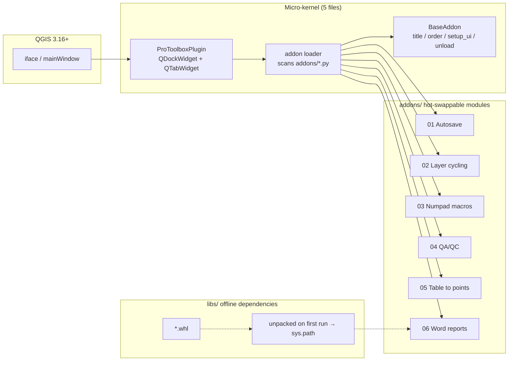

<div align="center">


[English](./README.md) | [简体中文](./README_zh.md)

### Hot-swappable · Zero-config · Crash-resistant

**Turn QGIS into an assembly line you can extend on the fly — not a program you reinstall every time you need one more button.**

[](https://qgis.org)
[](LICENSE)
[](https://www.python.org)
[]()
[](https://github.com/KGSINYA/qgis-pro-toolbox/pulls)

[Features](#-core-features) · [Architecture](#-architecture) · [3-minute addon](#-build-an-addon-in-3-minutes) · [Install](#-installation) · [Offline deps](#-offline-dependencies-zero-config) · [FAQ](#-faq)

</div>

> **Pro Toolbox** is a hot-swappable addon shell for QGIS: one 32-line `BaseAddon` contract, a runtime scanner, and offline wheels. Drop a `.py` file into `addons/`, click **Rescan**, and a new tab appears without restarting QGIS. Six production modules ship in the box: crash-proof autosave with one-click restore, arrow-key layer cycling, numpad macro input, semi-automatic QA/QC, table-to-point mapping with batch map export, and template-driven Word reports. No network calls, no telemetry.

---

## 🎯 Why Pro Toolbox?

The real cost of GIS digitizing is rarely "the software lacks a feature". It is **repetition × eight hours a day × every crash that takes the afternoon with it**.

| The problem on the floor | The usual workaround | What Pro Toolbox does |
| --- | --- | --- |
| QGIS dies after a long editing session | Save manually and hope you remember | Snapshots every layer being edited to its own GPKG on a timer, rotates by count, restores with one click |
| Flipping between imagery and vector layers in the panel | Four clicks per layer, eyes off the canvas | `←` / `→` cycle visibility inside the current group, with an on-canvas OSD showing the active layer |
| Pasting the same paragraph into the attribute table all day | Clipboard, input-method dictionaries | `Numpad 1–5` inject long preset texts (optionally with Enter) through Win32 hotkeys that never fight QGIS shortcuts |
| QA by squinting and ticking paper checklists | Manual comparison | `F4` marks the current feature as checked, then zooms to the next unchecked one |
| Excel coordinates need to become points — and maps | Three programs and a lot of copy-paste | Table to points, optional SHP export, and batch map export at 96/150/300 DPI |
| Every project needs the same Word report again | Copy, paste, reformat, repeat | Use an existing `.docx` as a template, map columns to fields or photos, generate one row per feature |

### Three design choices

**🧩 Hot-swappable micro-kernel**
The framework fits in five small files: `main.py` owns the dock, the tabs and the scanner, `base_addon.py` is a 32-line contract, `i18n.py` resolves the UI language, `__init__.py` is the entry point. **A new feature is a new file** — no framework edits, no reinstall, no QGIS restart.

**📦 Zero-config offline dependencies**
`libs/*.whl` ship with the plugin and are unpacked into `sys.path` on first use. No pip, no internet, no admin rights — `python-docx` still produces reports on an air-gapped intranet.

**⚡ Built for high-frequency digitizing**
Every interaction is designed around "hands on the keyboard, eyes on the canvas": arrow keys, numpad, one-key QA, one-click restore.

---

## ✨ Core features

| # | Module | Entry point | What it solves | Output / behaviour |
| --- | --- | --- | --- | --- |
| 01 | 💾 **Autosave & one-click restore** | Dock panel | Crashes and misclicks wiping out edits | `Backup_YYYYmmdd_HHMMSS/<layer>.gpkg`, configurable rotation (1–50, default 5) |
| 02 | 🗂️ **Layer cycling** | `←` / `→` | Clicking back and forth in the layer panel | Cycles visibility within the current group; OSD shows the active layer name |
| 03 | ⌨️ **Numpad macros** | `Numpad 1–5` | Retyping long, fixed phrases | Global hotkey → Unicode injection, optional auto-Enter; config persisted in a local JSON |
| 04 | ✅ **Semi-automatic QA/QC** | `F4` (or `F5` / `Space` / `F8`) | Manual page-turning QA | Initializes `QA_Status`, marks the selected feature, jumps to the next unchecked one |
| 05 | 📊 **Table to points & batch maps** | Dock panel | Excel coordinates to points to maps, across apps | Coordinate jump, DMS parsing, lon/lat swap correction, pick on canvas; CSV/XLSX → points, SHP export, batch map export |
| 06 | 📝 **Word reports** | Dock panel | Rebuilding the same report every cycle | Reads the first table header of a `.docx` template, maps columns to vector fields or external images, fills one row per feature |
| — | 🌐 **Bilingual UI** | Dock header | Mixed-language teams and reviewers | One click flips every tab, label and message between 中文 and English; addons reload in place and the choice is remembered |

### Technical specs

| Item | Details |
| --- | --- |
| Runtime | QGIS **3.16 – 3.99** (Qt5 / PyQt5) |
| Language | Python 3 (QGIS' bundled interpreter) |
| Third-party deps | `python-docx 1.2.0`, `lxml 6.1.3`, `typing_extensions 4.16.0` — bundled, nothing to install |
| Platforms | Windows / macOS / Linux (`03 Numpad macros` is Windows-only; everything else is cross-platform) |
| Network | No network requests, no data reporting |

---

## 🏗 Architecture



```
pro_toolbox/
├── __init__.py             # QGIS entry point: classFactory()
├── main.py                 # micro-kernel: dock + tabs + addon scanner
├── base_addon.py           # 32-line addon contract
├── i18n.py                 # runtime translator: tr("中文", "English")
├── metadata.txt            # official QGIS plugin metadata
├── LICENSE                 # full GPL-3.0 text (no extension, as required)
├── NOTICE                  # copyright and third-party licenses
├── icon.png                # plugin icon (declared in metadata)
├── build_zip.py            # one-command packaging into an uploadable ZIP
├── README.md               # this file (English)
├── README_zh.md            # the same document in Chinese
├── addons/
│   ├── 01_auto_save.py
│   ├── 02_layer_switch.py
│   ├── 03_numpad_macro.py
│   ├── 04_qaqc.py
│   ├── 05_excel_map.py
│   ├── 06_word_report.py
│   └── _template_addon.py  # template: leading underscore is never loaded
├── libs/                   # offline wheels (unpacked files are not committed)
└── docs/
    ├── banner.svg
    └── security-audit.md   # pre-release privacy audit
```

**Why is the core this small?**

1. **A minimal contract** — an addon needs `title`, `order` and `setup_ui(parent_widget)`; everything else is optional.
2. **Fault isolation** — if one addon fails to import or initialize, the shell shows a message-bar hint and **the other addons still load**.
3. **Reclaimable resources** — every addon has `unload()`; **Rescan** unloads old instances first, so no ghost timers or shortcuts survive.

---

## 🧩 Build an addon in 3 minutes

Create `addons/07_hello.py` — all it takes is these 15 lines:

```python
# addons/07_hello.py   ← the file name must not start with "_", or the loader skips it
from qgis.PyQt.QtWidgets import QVBoxLayout, QLabel
from base_addon import BaseAddon, tr


class HelloAddon(BaseAddon):
    title = tr("👋 你好模块", "👋 Hello addon")  # tab title, both languages
    order = 7                 # lower numbers come first

    def setup_ui(self, parent_widget):
        layout = QVBoxLayout(parent_widget)
        layout.addWidget(QLabel(tr("零重启挂载成功 —— 这就是微内核。",
                                   "Mounted with zero restarts — that is the micro-kernel.")))

    def unload(self):
        pass                  # stop timers / unregister shortcuts / quit threads here
```

Save the file → click **🔄 Rescan addons** at the top of the dock → the new tab appears. **No framework code changed, no QGIS restart.**

### Addon contract

| Member | Required | Purpose |
| --- | --- | --- |
| `title` | No | Tab label; defaults to `🧩 Untitled addon` |
| `order` | No | Sort weight; defaults to `99` (lower = earlier) |
| `setup_ui(parent_widget)` | **Yes** | Build the UI; `parent_widget` is an empty `QWidget` |
| `unload()` | No | Clean up on unload / rescan |
| `_is_pro_addon` | — | Framework flag; set it to `False` to hide the addon on specific platforms |

### Three golden rules

1. **Never start a file name with `_`** — the loader skips it (`_template_addon.py` lives in the repo precisely because of this).
2. **Do not do slow I/O inside `setup_ui`** — it runs on the UI thread; defer heavy reads with `QTimer.singleShot(0, ...)`.
3. **Any addon with timers, shortcuts or threads must implement `unload()`** — otherwise **Rescan** leaves ghost resources behind.

> A copy-ready [`addons/_template_addon.py`](addons/_template_addon.py) is included.

---

## 📥 Installation

### Option A — Install from ZIP (intranet / no Git required)

1. Download `pro_toolbox-1.0.0.zip` from [Releases](https://github.com/KGSINYA/qgis-pro-toolbox/releases);
2. In QGIS: **Plugins → Manage and Install Plugins → Install from ZIP**;
3. Pick the ZIP, then enable the plugin once installation finishes;
4. A 🛠️ icon appears on the toolbar — click it to open the toolbox.

> The ZIP must contain a single top-level folder named `pro_toolbox/`. `build_zip.py` guarantees that automatically.

### Option B — Clone the source (recommended for developers)

```bash
# Windows
cd "%APPDATA%\QGIS\QGIS3\profiles\default\python\plugins"
git clone https://github.com/KGSINYA/qgis-pro-toolbox.git pro_toolbox
```

```bash
# macOS
cd ~/Library/Application\ Support/QGIS/QGIS3/profiles/default/python/plugins
git clone https://github.com/KGSINYA/qgis-pro-toolbox.git pro_toolbox
```

```bash
# Linux
cd ~/.local/share/QGIS/QGIS3/profiles/default/python/plugins
git clone https://github.com/KGSINYA/qgis-pro-toolbox.git pro_toolbox
```

Restart QGIS and enable **Pro Toolbox** in the plugin manager.

### Verify the installation

Open the toolbox — the status label should read `Loaded modules: 6`. If an addon fails, the message bar names the file and the exception.

> UI language: follows QGIS' own locale on first launch (中文 for `zh_*`, English otherwise). Use the 🌐 selector at the top of the dock to switch at any time — no restart needed.

> Chinese users: see [README_zh.md](./README_zh.md) for the same document in Chinese.

---

## 🔌 Offline dependencies (zero config)

Four wheels are bundled in `libs/`:

| Wheel | Purpose |
| --- | --- |
| `python_docx-1.2.0-py3-none-any.whl` | Word reports |
| `typing_extensions-4.16.0-py3-none-any.whl` | Typing compatibility layer |
| `lxml-6.1.3-cp39-cp39-win_amd64.whl` | lxml for QGIS ≤ 3.39 (Python 3.9 / Windows x64) |
| `lxml-6.1.3-cp312-cp312-win_amd64.whl` | lxml for QGIS ≥ 3.40 (Python 3.12 / Windows x64) |

On first use, `06_word_report.py` picks the `lxml` wheel that matches the running
interpreter, unpacks the compatible wheels into `libs/_extracted/<abi tag>`
(e.g. `libs/_extracted/cp39`), puts that folder on `sys.path`, and writes a
`*.whl.unpacked` marker; later launches reuse the unpacked copy. Wheels for the
other Python version are ignored, so one ZIP works on both QGIS generations.

### ⚠️ Runtime requirements (read this first)

The `lxml` wheels in `libs/` are **precompiled binaries** tied to the Python
version inside QGIS. Both Windows generations are covered out of the box:

| Your QGIS (official Windows builds) | Bundled Python | Bundled wheel | What to do |
| --- | --- | --- | --- |
| **3.40 and newer** | **3.12** | `lxml-…cp312…` | nothing |
| **3.16 – 3.39** | **3.9** | `lxml-…cp39…` | nothing |
| macOS / Linux | varies | ❌ wrong platform | fetch the wheel for your `--platform` |

> QGIS 3.34.1 on Windows bundles **Python 3.9.5** and therefore uses the
> `cp39` wheel. The limit comes from the wheel ABI, **not from the plugin
> code**. The other five modules (autosave, layer cycling, numpad macros,
> QA/QC, table to points) do not touch `libs/` at all and run on QGIS 3.16+.

Check the Python version of your QGIS — **Plugins → Python Console**:

```python
import sys; print(sys.version)
```

Fetch a matching wheel on a machine with internet access (no version pin — pip picks the newest build for that Python):

```bash
# QGIS 3.16 – 3.39 (Python 3.9 / Windows x64)
python -m pip download lxml --only-binary=:all: --platform win_amd64 --python-version 39 --implementation cp -d libs

# QGIS 3.40+ (Python 3.12 / Windows x64)
python -m pip download lxml --only-binary=:all: --platform win_amd64 --python-version 3.12 --implementation cp -d libs
```

> Spreadsheet libraries such as `pandas` / `openpyxl` ship with QGIS and are not bundled.

---

## ⌨️ Shortcut reference

| Shortcut | Module | Action |
| --- | --- | --- |
| `←` / `→` | 02 Layer cycling | Previous / next visible layer in the current group |
| `Numpad 1` – `Numpad 5` | 03 Numpad macros | Inject preset text (optional auto-Enter), Windows only |
| `F4` | 04 QA/QC | Mark the current feature as checked and jump to the next unchecked one |
| `F5` / `Space` / `F8` | 04 QA/QC | Alternative bindings, selectable in the panel |

> Shortcuts for `02` and `04` can be enabled or disabled per panel, so they never collide with your project shortcuts.

---

## 🛡 Privacy and security

- **No network access**: there is no `urllib` / `requests` / `QNetwork` / `socket` / `subprocess` call anywhere in the code.
- **No telemetry**: no usage statistics, no registry writes, no project uploads.
- **Data stays local**: autosave writes to the folder you choose; Word reports go exactly where you point them.
- **Sanitized**: the repository contains no company names, intranet addresses, personal paths or project codenames. See [`docs/security-audit.md`](docs/security-audit.md) for details.

---

## ❓ FAQ

**Q: I clicked Rescan but the new tab did not appear.**
A: Check three things — the file name does not start with `_`, the class subclasses `BaseAddon`, and `setup_ui` has the signature `(self, parent_widget)`. The exact exception is shown in the QGIS message bar (View → Panels → Log Messages).

**Q: Where do autosaves go? Will they fill my disk?**
A: To the folder selected in the panel, one `Backup_<timestamp>/` folder per run. Set the maximum number of snapshots there; older ones are deleted automatically.

**Q: The Word module raises `No module named 'docx'` or `ImportError: DLL load failed`.**
A: The wheels in `libs/` do not match your QGIS Python. Both Windows ABIs ship in the box (`cp39` for QGIS ≤ 3.39 / Python 3.9, `cp312` for QGIS ≥ 3.40 / Python 3.12); macOS/Linux need a wheel built for that platform. See [Runtime requirements](#️-runtime-requirements-read-this-first).

**Q: My antivirus flags the numpad module.**
A: Module `03` uses Win32 `RegisterHotKey` + `SendInput` for global hotkeys and text injection — standard practice for input methods and automation tools, and it never injects into other processes. Disable the module if you prefer.

**Q: Is QGIS 4 / Qt6 supported?**
A: `qgisMaximumVersion=3.99` for now. Qt6 requires scoped enums (e.g. `Qt.Key_Left` → `Qt.Key.Key_Left`); that migration is well understood and PRs are welcome.

**Q: Does it run on macOS / Linux?**
A: Yes. Only `03 Numpad macros` depends on the Win32 API and hides itself automatically — the other modules are cross-platform.

---

## 🗺 Roadmap

- [x] `1.0.0` first public release: six production modules + hot-swappable loader
- [ ] QGIS 4 / Qt6 support
- [ ] Per-addon enable/disable switches with persisted settings
- [ ] Differential autosave (store only changed features)
- [ ] Translation packs (`.qm` / `zh_CN` etc.)

---

## 🤝 Contributing

PRs and issues are very welcome, especially:

- New `addons/` modules (please include a GIF or screenshot);
- Cross-platform work (hotkey alternatives on macOS / Linux);
- Documentation fixes and typo hunting.

Before submitting, make sure `python build_zip.py --dry-run` lists the expected files and no local config, cache or test data sneaks into the repository.

---

## 📄 License

Released under the [GNU General Public License v3.0](LICENSE) (`LICENSE` holds the full GPL-3.0 text; copyright and third-party licenses are in [NOTICE](NOTICE)).
The QGIS plugin repository requires every plugin to be GPL v2 or later; this project uses GPL-3.0.

---

## 👤 Author

| | |
| --- | --- |
| Author | KGSINYA |
| Email | [kgsinya@163.com](mailto:kgsinya@163.com) |
| GitHub | [@KGSINYA](https://github.com/KGSINYA) |
| Issues | [Issues](https://github.com/KGSINYA/qgis-pro-toolbox/issues) |

> If this project saved you an evening of overtime, a ⭐ is the best way to say thanks.

---

## ⚠️ Disclaimer

This project is not affiliated with QGIS.org or OSGeo; QGIS is a registered trademark of QGIS.org.
The plugin modifies layer fields and editing state in your project — **back up your project before using it on production data**. The author accepts no liability for data loss or production incidents.
