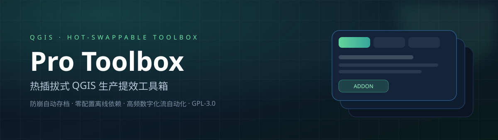
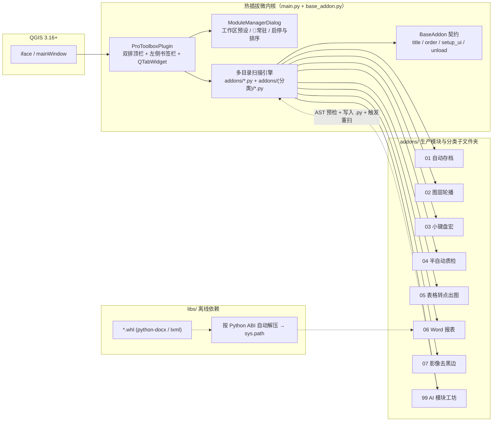

<div align="center">




[English](./README.md) | [简体中文](./README_zh.md)

### 热插拔 · AI 自进化 · 零配置 · 抗崩溃

**把 QGIS 变成一条可按需组装、用 AI 随时造工具的数字化生产线，而不是一台每次上新功能都要重装的软件。**

[](https://qgis.org)
[](https://github.com/KGSINYA/qgis-pro-toolbox/releases)
[](LICENSE)
[](https://www.python.org)
[]()
[](https://github.com/KGSINYA/qgis-pro-toolbox/pulls)

[🆕 v1.1.0 新特性](#-v110-重磅特性) · [📖 保姆级使用教程](#-保姆级实操教程新手必看) · [✨ 8大模块详解](#-8-大内置生产模块详解) · [🏗 架构一览](#-架构一览) · [🧩 3 分钟扩展](#-3-分钟扩展指南手写或用-ai-工坊皆可) · [📥 安装](#-安装) · [❓ FAQ](#-faq-常见问题解答)

</div>

> **English** — Pro Toolbox is a hot-swappable addon shell for QGIS: one 32-line `BaseAddon` contract, a multi-folder runtime scanner, an AI Module Studio, and offline wheels. Drop a `.py` file into `addons/`, click **Rescan**, and a new tab appears without restarting QGIS. Eight production modules ship in the box — crash-proof autosave with one-click restore, arrow-key layer cycling, numpad macro input, semi-automatic QA/QC, table-to-point mapping with batch map export, template-driven Word reports, a raster NoData cleaner, and an AI Module Studio — on top of a folder-based module library with collapsible horizontal bookmarks. No network calls, no telemetry.

> **Pro Toolbox** 是一个支持「热插拔 + AI 自进化」的插件底座：一份 32 行的 `BaseAddon` 契约、一个支持多子文件夹分类的运行时扫描器、一组离线 wheel。把 `.py` 丢进 `addons/`，点一下 **🔄 重新扫描加载模块**，新 Tab 立刻出现，无需重启 QGIS。内置 8 个生产模块：防崩自动存档与一键回溯、方向键图层轮播、小键盘宏文本录入、半自动质检、表格转点与批量出图、Word 模板报表、影像去黑边与匀光、AI 模块创造工坊；再配上一套可折叠左侧分类书签栏与工作区管理器。不联网、不埋点。

---

## 🆕 v1.1.0 重磅特性

| 新特性 | 一句话核心价值 |
|---|---|
| **✨ 99 · AI 模块创造工坊** | **把「我想要个小工具」变成 30 秒的事**：用大白话写下需求 → 一键复制自带基座接口规范的 AI 提示词 → 发给 DeepSeek/ChatGPT → 把生成的代码粘贴回来，工坊自动做 AST 语法与契约预检，一键写入 `addons/` 并热挂载成新 Tab！全程不重启 QGIS、不开代码编辑器！ |
| **🔖 左侧分类书签栏 & ⚙️ 模块工作区管理器** | **彻底告别顶栏 Tab 拥挤与手动剪切 `.py` 文件**：支持在 `addons/` 下按文件夹分类存放模块；左侧书签栏文字**水平正向显示（绝不歪脖子）**，一键折叠/展开；支持将通用模块设为 **`📌 全局常驻`**、用勾选框启停模块、用 `⬆️/⬇️` 自由调整顺序，并可保存多套【任务工作区方案】1 秒切换！ |
| **🖼️ 07 · 影像去黑边与匀光** | **专治正射影像 (DOM) 与历史扫描图的黑边/白边领口**：一键将 `0`（黑边）或 `255`（白边）写入附加 NoData，或将任意指定 RGB 像素精确透明化；支持开启**「自动监听新导入影像」**与双线性平滑重采样 + 对比度拉伸。 |
| **🧪 无头 QGIS 冒烟测试套件** | 新增 `tests/test_plugin_smoke.py`，无头启动 QGIS 挂载全部 8 个模块，自动校验 UI 构建、分类子文件夹发现、工作区 JSON 持久化与中英文实时切换。 |

---

## 📖 保姆级实操教程（新手必看）

最近版本新增了大量模块管理与 AI 造工具能力，哪怕你完全不懂编程，跟着下面 3 张流程表操作也能在 1 分钟内上手：

### 教程一：如何用【⚙️ 模块与分类管理】整理你的工具箱？（告别手动剪切文件）

当你安装的模块越来越多（比如既有日常通用模块，又有航拍专项模块、三调核查模块）时，按以下步骤管理：

| 步骤 | 在界面上点哪里？ | 发生什么效果？ |
|---|---|---|
| **第 1 步：打开管理器** | 点击插件顶栏第一排的 **`⚙️ 模块与分类管理`**（或左侧书签底部的 **`⚙️ 整理归类模块`**） | 弹出可视化树形管理器，自动列出 `addons/` 根目录及 `01_通用核心模块`、`02_遥感影像处理` 等 4 个预设分类文件夹。 |
| **第 2 步：把模块归入分类文件夹** | 在列表中点击选中某个模块（如 `07_影像去黑边`）→ 点击下方 **`📁 归入分类文件夹...`** → 选择 `02_遥感影像处理`（也可直接打字输入新文件夹名） | 插件自动在硬盘创建对应子文件夹并将 `.py` 移入；同时主界面**左侧书签栏**和**顶栏下拉框**会自动显示 `📂 02_遥感影像处理 (1)`！ |
| **第 3 步：设置通用模块「📌 全局常驻」** | 选中你每天都要用的模块（如 `01_自动存档`）→ 点击下方 **`📌 切换全局常驻(通用)`** | 该模块状态变为 **`📌 全局常驻`**。以后无论你在左侧书签切换到哪个专项文件夹，常驻模块都会**始终跟随显示在最前面**！ |
| **第 4 步：隐藏不用的模块 & 调整先后顺序** | • **不想显示某个模块**：直接取消勾选它前面的复选框 `⬜`<br>• **想调整 Tab 前后顺序**：选中模块点击 **`⬆️ 上移` / `⬇️ 下移`** | 完全不用去硬盘剪切文件，也不用去代码里改 `01_`、`02_` 序号！自定义排序优先级高于代码内置序号。 |
| **第 5 步：保存专属「任务工作区」** | 点击管理器右上角 **`➕ 新建工作区方案`**（例如输入 `🛩️ 航拍修图模式`），勾选该任务需要的跨文件夹模块组合，点击右下角 **`✅ 保存配置并立即刷新界面`** | 以后在主界面左边点一下书签（或顶栏下拉框选一下），0.1 秒切换整套面板！平时嫌左边书签占地方？点一下 **`◀ 收起左侧书签`** 即可完全折叠隐藏！ |

---

### 教程二：如何用【✨ 99. 模块工坊】让 AI 在 30 秒内为你造一个专属新工具？

不需要懂 PyQGIS 接口，工坊已经把本插件的底层契约（`BaseAddon`、`setup_ui`、`tr()` 双语包装）全部写进了提示词生成器里：

| 步骤 | 操作动作 | 防踩坑说明 |
|---|---|---|
| **第 1 步：写下你的想法并复制提示词** | 切换到最后一个 Tab **`✨ 模块工坊 (AI造工具)`**：<br>1. 填写模块文件名（默认自动顺延编号，如 `08_my_custom_tool.py`）和 Tab 标题。<br>2. 在第一个输入框用大白话描述需求（例如：*“做一个批量导出工具，把当前选中的矢量图层按指定字段拆分为多个 GeoJSON 文件并显示进度条”*）。<br>3. 点击蓝色按钮 **`📋 一键生成【防报错基座匹配提示词】并复制到剪贴板`**。 | 千万不要自己去跟 AI 空口聊“帮我写个QGIS插件”，一定要点这个蓝色按钮！它会把主程序的 `setup_ui(parent_widget)` 挂载规范一起复制给 AI，确保生成的代码 100% 匹配本工具箱。 |
| **第 2 步：发给任意 AI 并粘贴代码热挂载** | 1. 打开 DeepSeek / ChatGPT / Claude / Kimi，直接粘贴发送。<br>2. 把 AI 回复的 Python 代码复制回来，直接粘贴进工坊**第二步的代码框**里（哪怕带着 Markdown 代码块标记也没关系，工坊会自动剥离）。<br>3. 点击绿色按钮 **`⚡ 校验代码、写入 addons 并立即热加载！`**。 | 工坊会先用 Python AST 抽象语法树检查代码是否有语法错误、是否漏写了 `BaseAddon` 和 `setup_ui`；预检通过后自动保存并触发热加载，**新工具 Tab 当场出现在上方标签栏**！ |

---

### 教程三：如何用【🖼️ 07. 影像去黑边】一秒消除 TIF 正射影像的黑边/白边？

航拍拼接正射影像（DOM）或历史扫描图导入 QGIS 后，四周往往有一圈难看的黑色（`RGB=0,0,0`）或白色（`RGB=255,255,255`）无效边框：

| 场景 | 操作步骤 |
|---|---|
| **快速去黑边 / 去白边** | 切换到 **`🖼️ 07. 影像去黑边`** → 选择要处理的范围（`当前选中的栅格图层` 或 `工程中的所有栅格图层`）→ 点击 **`⬛ 一键去除黑边 (NoData = 0)`** 或 **`⬜ 一键去除白边 (NoData = 255)`**。瞬间全部透明！ |
| **自动化省心流（推荐）** | 勾选面板下方的 **`⚡ 自动为新导入的栅格图层去除黑边 (NoData=0)`**。开启后，你往 QGIS 里拖入任何新 TIF 影像，插件会在后台自动帮它去黑边并刷新画布，连按钮都不用点！ |
| **影像锯齿发虚 / 偏暗** | 点击 **`✨ 一键开启平滑重采样 + 最小最大对比度拉伸`**，自动为影像启用双线性平滑插值（Bilinear）与动态范围拉伸；做错任何一步，点 **`🔄 还原默认渲染`** 即可恢复原状。 |

---

## 🎯 为什么是 Pro Toolbox？

内业数字化真正的成本，从来不是「软件功能不够」，而是**重复动作 × 每天 8 小时 × 每一次意外崩溃**。

| 现场的真实痛点 | 常见做法 | Pro Toolbox 的做法 |
| --- | --- | --- |
| 连续作业一下午，QGIS 崩一次 = 半天白干 | 手动另存，靠记性 | 定时把**正在编辑的图层**快照成独立 GPKG，按数量轮转，一键回溯成新图层 |
| 影像/矢量比对要在图层面板里点来点去 | 鼠标点 4 次才切一张 | `←` / `→` 在组内轮播，画布顶部 OSD 提示，视线不用离开作业区 |
| 属性表里反复复制粘贴同一段话 | 输入法词库、复制粘贴 | 小键盘 `1–5` 直出长文本 + 自动回车，Win32 级注入，不抢 QGIS 快捷键 |
| 质检靠肉眼翻页、靠纸单勾选 | 人工比对 | `F4` 标记合格 → 自动缩放并跳到下一个未检要素 |
| Excel 坐标要变成图、再批量出图 | 跨 3 个软件 + 手工 | 表格转点、SHP 导出、96/150/300 DPI 批量出图一条龙 |
| 每个项目都要重做 Word 报表 | 复制粘贴到吐 | 拿现有 `.docx` 当模板，按表头映射字段与照片，批量生成 |
| 正射影像一圈大黑边遮挡底图 | 逐个右键属性手填透明值 | 一键批量设 NoData / RGB 透明，还能自动监听新拖入的影像 |
| 临时缺一个批处理小功能 | 等开发排期、重装插件 | 打开 99 模块工坊，30 秒让 AI 生成并热挂载到面板 |

---

## ✨ 8 大内置生产模块详解

| # | 模块名称 | 交互入口 | 解决什么痛点 | 核心功能与产出行为 |
| --- | --- | --- | --- | --- |
| **01** | 💾 **自动存档 & 一键回溯** | Dock 面板 | 崩溃、误删导致数小时编辑成果丢失 | 自动扫描处于编辑状态的矢量图层，定时快照为 `Backup_YYYYmmdd_HHMMSS/<图层>.gpkg`；支持设置最大保留份数自动轮转删旧；支持选中任意历史时间点**一键挂载回当前工程**比对找回。 |
| **02** | 🗂️ **图层轮播** | `←` / `→` 方向键 | 多期历史影像/方案对比时来回点图层树 | 锁定目标图层组后，按左右方向键在组内单选轮播切换可见性；画布顶部弹出半透明 OSD 横幅提示当前图层名，支持切换时自动缩放到图层范围。 |
| **03** | ⌨️ **小键盘宏录入** | `Numpad 1–5` | 属性表重复输入固定地类名称、核查话术 | 基于 Win32 底层拦截小键盘 `1–5`，直接向当前焦点单元格注入预设长文本（可选自动触发 `Enter` 换行），绝不与 QGIS 内置快捷键冲突；配置自动持久化。 |
| **04** | ✅ **半自动质检 (QA/QC)** | `F4`（可改绑） | 人工翻属性表逐行核查漏检、眼花 | 一键为图层初始化 `QA_Status` 与 `QA_Time` 字段；核查无误按一下 `F4`，自动写入“合格”时间戳，并立即平移缩放到下一个未检要素，顶部进度条实时显示完成率。 |
| **05** | 📊 **表格转点 & 批量出图** | Dock 面板 | 外业坐标定位、Excel 展点与多要素分幅出图 | 支持十进制度与度分秒（DMS）解析、**经纬度填反智能纠错**、图面取点反查；支持 CSV/XLSX 批量转点图层、导出标准 UTF-8 SHP，以及按打印布局模板批量导出 PNG/JPG/PDF。 |
| **06** | 📝 **Word 模板报表** | Dock 面板 | 外业调查表、巡检报告重复排版贴图 | 直接读取现有 `.docx` 表格首行表头，可视化配置每一列对应「矢量属性字段」还是「本地照片路径（自动按指定宽高嵌入图片）」，一键生成汇总报告或按要素拆分独立报告。 |
| **07** | 🖼️ **影像去黑边与匀光** | Dock 面板 | 正射影像黑边/白边遮挡、边缘锯齿 | 支持单图层或全工程批量设 NoData（0 黑边 / 255 白边 / 自定义值）、精确 RGB 像素透明化、新图层导入自动去黑边监听，以及一键开启双线性平滑重采样与对比度拉伸。 |
| **99** | ✨ **AI 模块创造工坊** | Dock 面板 | 个性化长尾需求没人写、不会配插件环境 | 输入需求一键复制【基座契约提示词】，将 AI 生成的 Python 代码粘回工坊，自动清理 Markdown 标记、执行 AST 语法与 `BaseAddon` 接口预检，一键写入 `addons/` 并热重载生效。 |
| **核心** | 🔖 **左侧书签 & 模块管理** | 左侧栏 / 顶栏 | 模块过多导致标签栏爆满、按项目切换繁琐 | 支持多子文件夹物理分类（自动映射为左侧水平书签）、`📌 全局常驻` 通用模块置顶、复选框免剪切启停、`⬆️/⬇️` 排序覆盖与多工作区方案秒切。 |
| **核心** | 🌐 **中英双语实时切换** | 顶栏右上角 | 中英文团队混用、国际化开源协作 | 基于 `tr("中文", "English")` 运行时解析，随时在顶栏切换 `🌐 中文界面 / English`，全部模块与分类书签就地重载并记忆偏好，无需编译 `.qm`。 |

---

## 🏗 架构一览



```text
pro_toolbox/
├── __init__.py             # QGIS 入口：classFactory()
├── main.py                 # 微内核：双排顶栏 + 左侧可折叠书签栏 + 模块管理器 + 多目录扫描器
├── base_addon.py           # 32 行的模块契约
├── i18n.py                 # 运行时双语翻译器：tr("中文", "English")
├── metadata.txt            # QGIS 官方插件元数据 (v1.1.0)
├── LICENSE                 # GPL-3.0 全文（无扩展名，官方要求）
├── NOTICE                  # 版权声明与第三方依赖许可
├── icon.png                # 插件图标（metadata 中声明）
├── icon.svg                # 插件图标的矢量母版
├── assets/
│   ├── logo.png            # README 使用的 512 px 品牌图
│   └── logo.svg            # README 品牌图的矢量母版
├── build_zip.py            # 一键构建完整版与 light 轻量版发布包
├── README.md               # 英文文档
├── README_zh.md            # 本文件（中文详尽文档）
├── addons/
│   ├── 01_auto_save.py
│   ├── 02_layer_switch.py
│   ├── 03_numpad_macro.py
│   ├── 04_qaqc.py
│   ├── 05_excel_map.py
│   ├── 06_word_report.py
│   ├── 07_raster_cleaner.py
│   ├── 99_module_studio.py
│   ├── _template_addon.py  # 开发者模板：下划线开头不会被加载
│   ├── 01_通用核心模块/      # 预设分类文件夹（放入其中的 .py 自动归入对应左侧书签）
│   ├── 02_遥感影像处理/
│   ├── 03_矢量与拓扑处理/
│   └── 04_属性与报表工具/
├── libs/                   # 离线 wheel（解压产物与本地配置不入库）
├── tests/
│   └── test_plugin_smoke.py  # 无头 QGIS 冒烟测试
└── docs/
    ├── banner.svg
    └── security-audit.md   # 开源前脱敏审计报告
```

---

## 🧩 3 分钟扩展指南（手写或用 AI 工坊皆可）

除了直接在插件内的 **✨ 99. 模块工坊** 一键生成挂载外，如果你喜欢手写代码，只需在 `addons/`（或任意分类子文件夹）下新建 `08_hello.py`，一共 15 行：

```python
# addons/08_hello.py   ← 文件名不能以 "_" 开头，否则会被加载器跳过
from qgis.PyQt.QtWidgets import QVBoxLayout, QLabel
from base_addon import BaseAddon, tr


class HelloAddon(BaseAddon):
    title = tr("👋 你好模块", "👋 Hello addon")  # Tab 标题（中 / 英）
    order = 8                 # 默认排序权重，越小越靠前（也可在模块管理器中随时上下调整）

    def setup_ui(self, parent_widget):
        layout = QVBoxLayout(parent_widget)
        layout.addWidget(QLabel(tr("零重启挂载成功 —— 这就是微内核。",
                                   "Mounted with zero restarts — that is the micro-kernel.")))

    def unload(self):
        pass                  # 在这里停定时器 / 注销快捷键 / 断开信号
```

保存 → 在 Dock 顶部点 **🔄 重新扫描加载模块** → 新 Tab 立刻出现。没有改过一行框架代码，也没有重启 QGIS。

### 模块契约与三条铁律

| 成员 | 必需 | 作用 |
|---|---|---|
| `title` | 否 | Tab 名称，建议使用 `tr("中文", "English")` 双语声明 |
| `order` | 否 | 默认排序权重（数字越小越靠前；用户在 ⚙️ 模块管理中调整的顺序优先于此默认值） |
| `setup_ui(parent_widget)` | **是** | 构建 UI；`parent_widget` 是一个空的 `QWidget`，直接在上面挂载 `QVBoxLayout(parent_widget)` 即可 |
| `unload()` | 否 | 卸载 / 重扫时清理资源（停止定时器、断开 QGIS 信号或注销快捷键） |
| `_is_pro_addon` | — | 框架识别标记；子类置 `False` 可让模块在特定平台自动隐藏 |

---

## 📥 安装

### 方式 A：ZIP 离线安装（最推荐，开箱即用）

在 [Releases](https://github.com/KGSINYA/qgis-pro-toolbox/releases) 页面提供两个版本的安装包：

- **`pro_toolbox-1.1.0.zip`（完整离线版，推荐）**：内置 `libs/` 离线依赖包，在无外网的内网电脑上也能直接使用 **06 Word 报表** 全部功能。
- **`pro_toolbox-1.1.0-light.zip`（轻量版）**：不含离线 `.whl`，体积更小，适合已配置好 Python 环境或不需要 Word 报表模块的用户。

安装步骤：

1. 下载上述任意一个 `.zip` 文件（无需手动解压）；
2. 打开 QGIS → 顶部菜单 **插件 (Plugins) → 管理并安装插件 (Manage and Install Plugins) → 从 ZIP 安装 (Install from ZIP)**；
3. 选择下载的 ZIP 包，点击 **安装插件**；
4. 安装完成后，在「已安装」列表中确认勾选 **Pro Toolbox**，工具栏出现 🛠️ 图标，点击即可打开工具箱！

### 方式 B：源码克隆（开发者推荐）

```bash
# Windows
cd "%APPDATA%\QGIS\QGIS3\profiles\default\python\plugins"
git clone https://github.com/KGSINYA/qgis-pro-toolbox.git pro_toolbox
```

```bash
# macOS
cd ~/Library/Application\ Support/QGIS/QGIS3/profiles/default/python/plugins
git clone https://github.com/KGSINYA/qgis-pro-toolbox.git pro_toolbox
```

```bash
# Linux
cd ~/.local/share/QGIS/QGIS3/profiles/default/python/plugins
git clone https://github.com/KGSINYA/qgis-pro-toolbox.git pro_toolbox
```

### 验证安装

- 打开工具箱 → 顶栏状态应显示 **`当前显示: 8 个模块`**（在 `🌟 全部模块` 视图下）。
- 界面语言首次启动自动跟随 QGIS 语言，随时可点击顶栏右上角 **`🌐 中文界面 / English`** 无缝切换。

---

## 🔌 内网离线依赖（Zero-Config）

完整版 `libs/` 中内置了四个 wheel，专为无网内网环境打造：

| Wheel | 用途 |
|---|---|
| `python_docx-1.2.0-py3-none-any.whl` | Word 模板报表生成 |
| `typing_extensions-4.16.0-py3-none-any.whl` | 类型标注兼容层 |
| `lxml-6.1.3-cp39-cp39-win_amd64.whl` | 适配 QGIS ≤ 3.39（Python 3.9 / Windows x64） |
| `lxml-6.1.3-cp312-cp312-win_amd64.whl` | 适配 QGIS ≥ 3.40（Python 3.12 / Windows x64） |

首次使用 Word 报表时，`06_word_report.py` 会按当前 QGIS 的 Python 解释器版本自动挑选匹配的 lxml wheel，解压到 `libs/_extracted/<ABI 标签>` 并挂载到 `sys.path`。其余 7 个模块完全不依赖 `libs/`，在任何 QGIS 3.16+ 环境下均可直接运行。

---

## ⌨️ 快捷键速查

| 快捷键 | 所属模块 | 触发动作 |
|---|---|---|
| `←` / `→` | 02 图层轮播 | 在锁定的图层组内切换上一个 / 下一个图层可见性 |
| `Numpad 1 – Numpad 5` | 03 小键盘宏 | 向当前属性表焦点框注入预设长文本（可设自动回车），仅 Windows |
| `F4`（可改绑 F5/Space/F8） | 04 半自动质检 | 标记当前要素 `QA_Status` 为合格，并自动缩放跳转到下一个未检要素 |

> 注：02、03、04 的快捷键监听均可在各自面板中随时开启或关闭，关闭后完全释放按键，绝不干扰日常打字或画图快捷键。

---

## 🛡 隐私与安全

- **零联网**：代码中不存在任何 `urllib` / `requests` / `QNetwork` / `socket` / `subprocess` 调用，插件不会向外发送任何数据（99 模块工坊采用剪贴板复制提示词与粘贴代码设计，无需配置 API Key 也不发起网络请求，内网物理隔离环境同样可用）。
- **零遥测**：不收集使用统计、不写注册表、不上传工程信息。
- **配置仅留本机**：工作区预设与模块排序保存在本地 `addons/workspace_config.json`，已列入 `.gitignore` 与打包排除列表，绝不污染代码仓库。

---

## ❓ FAQ 常见问题解答

**Q1：我在模块管理器里把模块移进了分类文件夹，怎么快速切过去看？**

A：直接点击主界面左侧【🔖 功能区与分类书签】里的对应文件夹（如 `📂 02_遥感影像处理`），或者在顶栏第二排的【🗂️ 当前功能区】下拉框里选择该文件夹，右侧就会只显示该文件夹下的模块 + 你设为 `📌 全局常驻` 的模块！

**Q2：我觉得左侧书签栏平时占宽度，能关掉吗？**

A：可以！直接点击顶栏第二排绿色的 **`◀ 收起左侧书签`** 按钮，左侧栏就会 100% 彻底折叠隐藏，你依然可以用旁边的下拉框秒切所有工作区和分类文件夹。

**Q3：用 AI 生成代码粘进 99 模块工坊时提示「未检测到 setup_ui 方法」？**

A：说明你没有使用工坊第一步生成的提示词，AI 自己瞎猜了别的接口名（比如写成了 `initGui` 或 `get_widget`）。只需在工坊第一步点蓝色按钮复制【防报错基座匹配提示词】重新发给 AI，生成的代码就 100% 能通过预检！

**Q4：修改了 main.py 主框架代码后，点「重新扫描加载模块」为什么主界面布局没变？**

A：「重新扫描加载模块」是用来热重载 `addons/` 下的所有子模块的；如果你修改了微内核底座 `main.py` 本身，只需在 QGIS 菜单 **插件 → 管理并安装插件 → 已安装** 中把 Pro Toolbox 取消勾选再重新勾选一次（耗时 1 秒，同样无需重启 QGIS），主框架就会立即换上新界面！

**Q5：杀毒软件对 03 小键盘宏录入报警？**

A：03 模块使用 Windows 原生 `RegisterHotKey` + `SendInput` API 实现全局热键与文本注入，这是输入法、按键精灵等工具的标准做法，不涉及任何恶意行为。如不需要可在模块管理器中取消勾选隐藏该模块。

---

## 🗺 Roadmap

- [x] **1.0.0** 首个公开版本：6 个生产模块 + 热插拔加载器
- [x] 中英文界面运行时双语一键切换（`i18n.py`）
- [x] 模块启用 / 禁用开关与配置持久化（`workspace_config.json`）
- [x] **1.1.0** 按文件夹分类的模块库与可折叠水平书签栏、工作区预设与模块管理器、07 影像去黑边、99 AI 模块创造工坊、无头冒烟测试
- [ ] **1.2.0** 模块配置导入/导出分享包（一键导出团队标准工作区 + 专属模块合集）
- [ ] QGIS 4 / PyQt6 兼容适配
- [ ] 自动存档的增量差异备份（仅存变更要素）

---

## 🤝 参与贡献

PR 与 Issue 都非常欢迎，尤其是：

- 用 **99 AI 模块工坊** 创造出的好用 `addons/` 新模块（欢迎提交 PR 分享给社区，请附带一段简短说明或截图）；
- 跨平台适配与文档完善。

提交前请确认：`python build_zip.py --dry-run` 能正常列出文件，且没有把本地 `workspace_config.json`、缓存或测试数据带进仓库。

---

## 📄 许可证

- 本项目基于 **GNU General Public License v3.0** 发布（`LICENSE` 为 GPL-3.0 全文，版权归属与第三方依赖许可见 `NOTICE`）。
- QGIS 官方插件仓库要求所有插件使用 GPL v2 或更高版本协议，本项目选择 GPL-3.0。

---

## 👤 作者

| | |
|---|---|
| 作者 | **KGSINYA** |
| 邮箱 | kgsinya@163.com |
| GitHub | [@KGSINYA](https://github.com/KGSINYA) |
| 问题反馈 | [Issues](https://github.com/KGSINYA/qgis-pro-toolbox/issues) |

如果这个项目帮你省下了加班时间，去 GitHub 点一个 ⭐ Star 就是最好的支持！

---

## ⚠️ 免责声明

- 本项目独立开发，与 QGIS.org / OSGeo 无官方隶属关系，QGIS 是 QGIS.org 的注册商标。
- 插件部分功能会修改当前工程的图层属性或编辑状态，请在重要生产数据上使用前先备份工程（或开启 **01 自动存档** 模块）。作者不对因使用本软件导致的任何数据丢失或生产事故承担连带责任。
